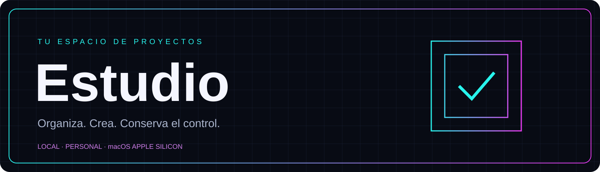
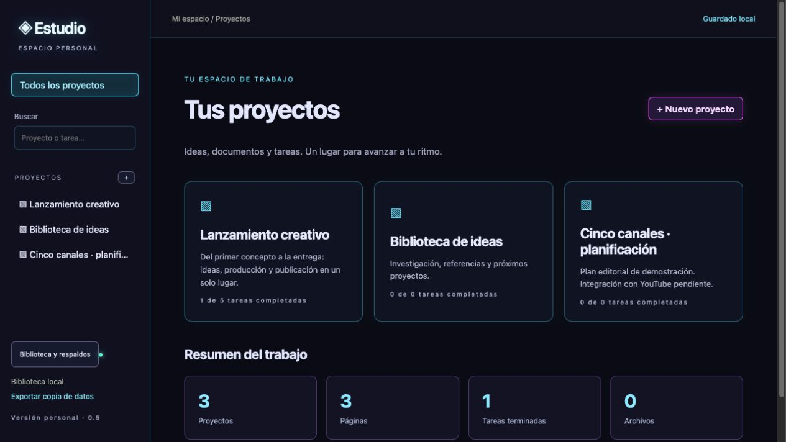
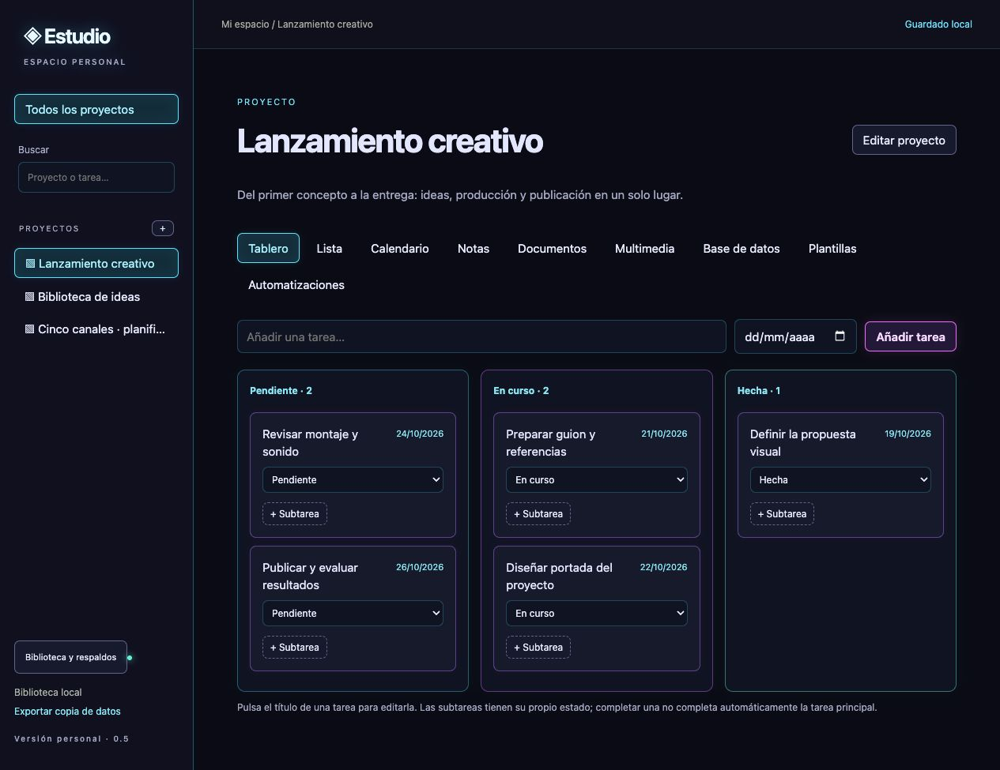

<p align="center"></p>

# Estudio

Un espacio personal para organizar proyectos, tareas, documentos y archivos. Funciona en tu Mac, guarda tu biblioteca localmente y combina una interfaz oscura con bordes neón.

**Versión 0.5.0 · Interfaz en español · macOS Apple Silicon · Uso individual**



## Qué puedes hacer

- Organizar proyectos con tareas, subtareas, lista, tablero Kanban y calendario.
- Escribir páginas y subpáginas con formato enriquecido, tablas, listas y casillas.
- Recuperar versiones anteriores de tus documentos.
- Adjuntar imágenes, audio, vídeo y archivos; reproducir formatos compatibles con el navegador.
- Añadir propiedades, relaciones simples y fórmulas aritméticas a las páginas.
- Explorar colecciones como tabla, galería y gráfico por categoría.
- Reutilizar plantillas y crear tareas de seguimiento con automatizaciones locales.
- Importar Markdown y tareas CSV; exportar documentos y datos.
- Mantener la biblioteca en un SSD externo y crear respaldos verificables con archivos incluidos.

## Primer inicio

Necesitas **Node.js 26 o superior**. La aplicación web utiliza SQLite incluido en Node y se sirve únicamente en la interfaz local.

```sh
cd app
npm ci --ignore-scripts
npm run build:editor
npm test
npm start
```

Abre **http://127.0.0.1:4317**. Para detenerla, pulsa `Ctrl+C` en la terminal. El primer inicio crea una biblioteca vacía en `app/data`; los datos y ajustes están excluidos de Git.

Para la aplicación de escritorio, consulta la [guía de macOS](docs/INSTALACION.md). La distribución nativa requiere **macOS 13.5 o posterior y Apple Silicon**, incluido M2.

## Una biblioteca, varias formas de trabajar

| Espacio | Uso |
| --- | --- |
| Tareas | Lista, tablero y calendario para el trabajo diario |
| Páginas | Documentación jerárquica con historial |
| Colecciones | Propiedades, filtros, galería y distribución por categoría |
| Archivos | Material de referencia junto al proyecto |
| Biblioteca | Ubicación, respaldos y restauración |



[Ver el editor de documentos](docs/images/documentos.png)

Las capturas utilizan exclusivamente datos ficticios de demostración.

## Arquitectura

La ventana nativa usa **Swift y WKWebView**. Un proceso Node local atiende la interfaz y conserva los datos en **SQLite**, mientras los adjuntos se guardan como archivos. El editor integra **Tiptap**, empaquetado con esbuild. No necesita una cuenta ni una API externa para sus funciones locales.

[Arquitectura y datos](docs/ARQUITECTURA.md) · [Desarrollo](docs/DESARROLLO.md) · [Roadmap](docs/ROADMAP.md) · [Cambios](CHANGELOG.md)

## Alcance actual

Estudio es una aplicación personal en desarrollo. Las integraciones con Notion, YouTube, IA y sincronización entre equipos están pendientes. No replica todas las funciones de Notion: las relaciones son simples, las fórmulas son aritméticas y la importación no acepta un espacio completo de Notion. El exportador JSON no incluye los archivos binarios; utiliza el respaldo completo para conservarlos.

La compilación de macOS tiene firma local de desarrollo; no está firmada con Developer ID ni notarizada por Apple. No se incluye un instalador personal ni datos del usuario dentro del repositorio.

## Calidad y colaboración

Incluye pruebas para persistencia, migraciones, conflictos de revisión, jerarquías, importación, automatizaciones, multimedia y restauración. El flujo de GitHub Actions instala dependencias, reconstruye el editor y ejecuta la suite en Linux y macOS. Su resultado remoto estará disponible después de publicar el repositorio.

Lee [CONTRIBUTING.md](CONTRIBUTING.md) y [SECURITY.md](SECURITY.md) antes de reportar un problema.

## Licencias

El código propio se entrega con **todos los derechos reservados**, pendiente de que su titular elija una licencia de distribución. La publicación del repositorio no concede una licencia de software libre. Las dependencias conservan sus respectivas licencias: [avisos de terceros](app/THIRD-PARTY-NOTICES.txt).
