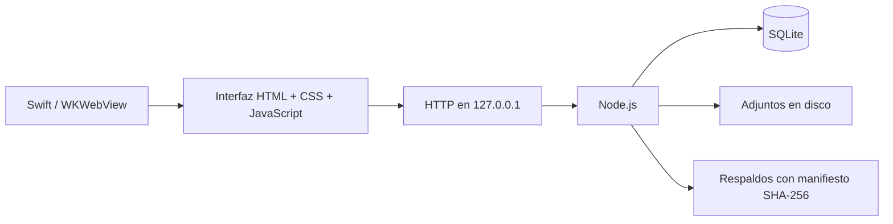

# Arquitectura y límites

## Componentes

| Archivo | Responsabilidad |
| --- | --- |
| `app/server.mjs` | Rutas locales, validación de origen y coordinación de biblioteca |
| `app/store.mjs` | Esquema, migraciones, transacciones y revisiones |
| `app/library.mjs` | Identidad de biblioteca y comprobación del dispositivo |
| `app/backup.mjs` | Copia consistente, verificación y restauración separada |
| `app/media.mjs` | Recepción de adjuntos y reproducción por rangos |
| `app/formats.mjs` | Importación Markdown/CSV y exportación Markdown |
| `app/formula.mjs` | Evaluador aritmético sin ejecutar código del usuario |
| `app/rich-schema.mjs` | Validación del documento enriquecido |
| `app/public/` | Interfaz oscura y módulos de vistas |
| `app/native/Estudio.swift` | Ventana, proceso local y selectores de archivos |

## Persistencia

SQLite usa claves externas, WAL y sincronización FULL. Las páginas y tareas incluyen revisiones para detectar cambios concurrentes. Cada guardado de página crea una versión; restaurar genera otra versión en lugar de borrar la historia. Las migraciones conservan copias previas cuando corresponde.

La biblioteca contiene `estudio.sqlite`, sus archivos auxiliares, un marcador de identidad y adjuntos. Los respaldos combinan una instantánea SQLite con archivos verificados. La identidad y el dispositivo se vuelven a comprobar para detectar desconexiones o sustitución del SSD.

## Modelo de confianza

Es una aplicación de un solo usuario, sin autenticación multiusuario. El servicio escucha exclusivamente en loopback, comprueba Host y exige el Origin local en escrituras. Los archivos se identifican y ciertos formatos se ofrecen únicamente como descarga. Estas medidas no convierten al servidor en un servicio apto para Internet.

No hay cifrado propio, colaboración en tiempo real ni sincronización automática. La protección del disco depende del sistema y de la configuración de almacenamiento del usuario. Los respaldos deben tratarse como datos privados.

## Decisiones

WKWebView reutiliza el motor del sistema y evita distribuir Chromium. El runtime Node oficial se incorpora al paquete macOS para no depender de Homebrew. El backend usa SQLite nativo de Node, por lo que requiere Node 26 en esta versión. El editor se reconstruye con dependencias fijadas y un lockfile.
